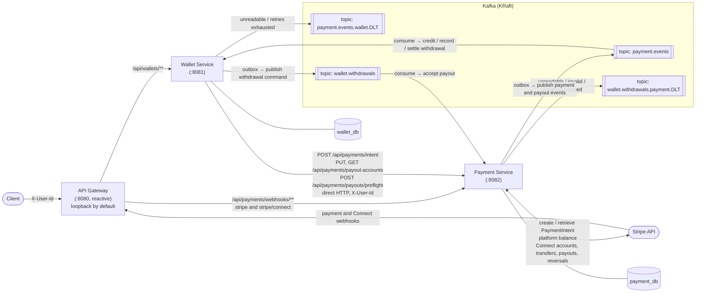
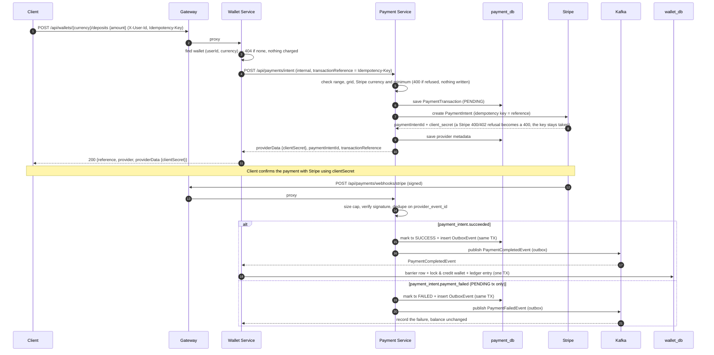
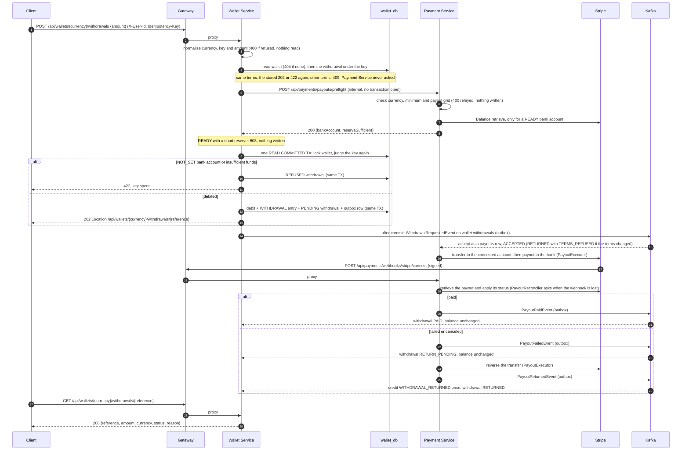

# FlowWallet architecture

This file explains how FlowWallet works: the module layout, the deposit flow, the transactional outbox, the wallet's
idempotent consumer, transfers between wallets, withdrawals, and the identity and security model. For what the project
is and its status, see [README.md](README.md); to run, configure and test it, see
[docs/development.md](docs/development.md); to change it, see [CONTRIBUTING.md](CONTRIBUTING.md). ADRs in
[docs/adr/](docs/adr/) record each design decision along with its rejected alternatives and consequences.

**Reference**
- [Business rules](docs/business-rules.md)
- [API reference](docs/api.md)
- [Data model](docs/data-model.md)
- [Kafka topics & events](docs/events.md)
- [Operator runbook](docs/operations.md)

## Architecture

FlowWallet is a 6-module Maven reactor. A reactive API Gateway sits in front of two servlet-based domain services.
Wallet Service calls Payment Service over HTTP, directly rather than through the gateway, to start a deposit, to relay
the caller's bank account and to check a withdrawal before it debits one. It sends each debited withdrawal to Payment
Service as a command on `wallet.withdrawals`, and Payment Service reports the outcomes of payments and payouts back on
`payment.events`. The gateway exposes all of Wallet Service but only the webhook path of Payment Service.



- The API Gateway is a reactive Spring Cloud Gateway that routes by path only (no `StripPrefix`) and applies
  CORS globally. It sends `/api/wallets/**` to Wallet Service and only `/api/payments/webhooks/**` to
  Payment Service, so a payment can't be started from outside except through a wallet. It caps how long it
  waits for an upstream to answer or to connect (`GATEWAY_HTTPCLIENT_RESPONSE_TIMEOUT` /
  `_CONNECT_TIMEOUT_MS`), because Spring Cloud Gateway's Netty client otherwise never times out a response
  and its connection pool is unbounded.
- Payment Service handles the Stripe integration, transaction persistence, webhooks, the outbox, the preflight that
  checks a withdrawal before its debit, the payouts it accepts from Wallet Service's withdrawal commands, and the
  connected account and bank account each user sets. It knows nothing about wallets: it takes an instruction and
  answers.
- Wallet Service owns wallets, balances, balance history and withdrawals (`wallet_db`) and serves `/api/wallets`. It
  starts a deposit by checking that the wallet exists and then asking Payment Service for a PaymentIntent, and relays
  the caller's bank account to Payment Service. It debits a withdrawal once Payment Service's preflight allows it, and
  sends the withdrawal on through its own outbox as a command on `wallet.withdrawals`. It consumes `payment.events`,
  crediting each completed payment and each returned withdrawal exactly once, recording failed payments without moving
  money, and raising each withdrawal's status from its payout events. A transfer between two wallets stays inside it:
  Payment Service and Kafka take no part.
- Platform holds shared servlet-side infrastructure built on Spring Web MVC: RFC 9457 error handling and the
  `@CurrentUserId` resolver (both auto-configured, servlet apps only), plus an `@Iso4217Currency`
  validation constraint.
- Contract holds the Kafka event payloads, the `payment.events` and `wallet.withdrawals` topic names, the `eventType`
  header name and its values, and the payload schema versions. It declares no dependencies of its own and its code uses
  nothing outside the JDK, so it adds nothing to a consumer's classpath. The events are plain records, and a consumer
  brings its own serializer.
- Outbox holds the transactional outbox: the `outbox_events` entity and its claim queries, the send after the
  commit, the poller and the `outbox` actuator endpoint, auto-configured in a service that depends on it. Payment
  Service sends its events through it, and Wallet Service its withdrawal commands.
- Each service has its own database. `payment_db` and `wallet_db` are separate, and neither service touches
  the other's.

## Modules

```
flow-wallet (parent POM)
├── flow-wallet-platform   error handling, @CurrentUserId, ISO 4217 validation, transport constants
├── flow-wallet-contract   Kafka events, topics, eventType header — nothing beyond the JDK
├── flow-wallet-outbox     transactional outbox: outbox_events, sender, poller, outbox endpoint
├── flow-wallet-gateway    API Gateway (reactive) — routing + CORS
├── flow-wallet-service    Wallet Service — wallets, deposits, transfers, withdrawals, balance history, event consumer
└── flow-wallet-payment    Payment Service — Stripe, transactions, webhooks, outbox, withdrawal-command consumer
```

Platform and contract are separate modules because they follow different rules. Platform is ordinary shared code,
changed as freely as anything else. Outbox is shared code too, kept out of platform because it brings persistence and
Kafka ([ADR 0034](docs/adr/0034-shared-outbox-and-the-wallet-withdrawals-command.md)). Contract is the boundary between
services. Producer and consumer are deployed separately, so a topic always holds messages written by more than one
version of the code, and changes there follow evolution rules: add optional fields only, never rename, remove or retype
a field in place, keep enums off the wire. A DTO that belongs to one service lives in that service. The module split is
explained in [ADR 0002](docs/adr/0002-module-boundaries.md) and the contract rules in
[ADR 0009](docs/adr/0009-payment-event-contract.md).

| Module | Port | Responsibility |
|--------|------|----------------|
| `flow-wallet-gateway` | 8080 | Route `/api/wallets/**` to Wallet Service and only `/api/payments/webhooks/**` to Payment Service; CORS. |
| `flow-wallet-service` | 8081 | List, open and read wallets; cursor-paged balance history; deposit initiation (calls Payment Service over HTTP); transfers between two users' wallets in one currency; the caller's bank account, relayed to Payment Service; withdrawals to that bank account, checked with Payment Service before the debit and sent on as commands through the transactional outbox, with the `outbox` actuator endpoint on `:8081`; Kafka consumer that credits balances idempotently and settles withdrawals from payout events, with a dead-letter topic. |
| `flow-wallet-payment` | 8082 | Payment intents, bank accounts and the withdrawal preflight (internal), Stripe webhooks, transactional outbox → Kafka; Kafka consumer that accepts withdrawal commands as payouts, with a dead-letter topic; payout executor that transfers, pays out and reverses through Stripe Connect; payout reconciler that settles payouts whose Connect webhook is lost; the `payouts` actuator endpoint, off by default, as an operator's exit from `NEEDS_ATTENTION`. |
| `flow-wallet-platform` | (library) | RFC 9457 error handling, `@CurrentUserId` auto-configuration, `@Iso4217Currency`, the `X-User-Id` header constant. |
| `flow-wallet-outbox` | (library) | Transactional outbox: the `outbox_events` entity and its claim queries, the send after the commit, the poller with its reaper and cleanup, the `outbox` endpoint and the `outbox.events.failed` gauge. |
| `flow-wallet-contract` | (library) | `PaymentCompletedEvent`, `PaymentFailedEvent`, the payout events and `WithdrawalRequestedEvent`, the `payment.events` and `wallet.withdrawals` topics, the `eventType` header and its values. |

## Architecture decisions

Design decisions that span more than one file are written up as architecture decision records (ADRs) in
[`docs/adr/`](docs/adr/), one file per decision, each with its context, the alternatives that were rejected and
the consequences. [`docs/adr/README.md`](docs/adr/README.md) is the index. This file describes how the
system behaves and links the relevant ADR where a section needs the reasoning behind it.

## End-to-end deposit flow

A deposit starts with a synchronous request that hands the client a payment credential. The money moves
later, when the asynchronous confirmation arrives. Why a deposit starts in the wallet and is reserved before
Stripe is called is in [ADR 0013](docs/adr/0013-deposit-initiation.md).



Payment Service answers a retry under the same key from the row that holds the key. An initiated row returns
the original intent, and a row that was reserved but never initiated calls Stripe again under the same
idempotency key ([ADR 0005](docs/adr/0005-client-supplied-idempotency-keys.md)). Two requests with the same key
and terms that race for the reservation get the same treatment: the loser receives the winner's intent, or a
`503` while the winner is still waiting for Stripe, which the wallet passes on as a `502` to retry under the same
key. The Stripe call has its own connect and read timeouts and no network retry by default, so it ends before
the wallet stops waiting ([ADR 0024](docs/adr/0024-deposit-initiation-settles-its-own-races.md)).
[ADR 0022](docs/adr/0022-stripe-charge-rules-checked-before-the-reservation.md) covers which refusals come
before the reservation and how a refusal from Stripe itself is answered. The intent offers only the payment methods
in `STRIPE_PAYMENT_METHOD_TYPES`, cards by default ([ADR 0028](docs/adr/0028-deposits-accept-cards-only.md)).

The webhook is the usual way a payment settles, but not the only one. `PendingPaymentReconciler` runs every five
minutes and asks Stripe about deposits that are still `PENDING`, or `FAILED` after a decline, 15 minutes to a day
after they started. A succeeded intent is applied as a success and a canceled one as a failure, through the same
`PaymentTransactionHandler` and checks as a webhook, so the wallet is credited even when the webhook is lost. Each
row is claimed with a conditional update of `last_reconciled_at` before Stripe is called, so instances do not ask
twice, and nothing is held open during the call. The reconciler never cancels an intent. Each payment it completes
is logged at WARN, because it means a webhook was lost, and every outcome is counted in
`payment.reconciliation.outcomes` ([ADR 0032](docs/adr/0032-pending-payments-are-rechecked-with-the-provider.md)).

## The Transactional Outbox

Neither service publishes to Kafka straight from business logic. In the same database transaction that makes the change
an event reports, the service also writes a row to `outbox_events`, so the event exists if and only if the change
commits. In Payment Service, `PaymentOutboxService` builds the payment event and chooses the `eventType` header from its
type, in one place for both events, and `PayoutOutboxService` does the same for the payout events. In Wallet Service,
`WithdrawalHandler` writes the withdrawal command in the transaction that debits the wallet. Both services write the row
through `Outbox.enqueue` from the shared `flow-wallet-outbox` module, which requires that transaction
(`Propagation.MANDATORY`) and fails when called without one. Each service owns its own `outbox_events` table, in
`payment_db` and in `wallet_db`, and names its topic with an `OutboxTopic` bean: `payment.events` for Payment Service,
`wallet.withdrawals` for Wallet Service. The reasoning is in [ADR 0008](docs/adr/0008-transactional-outbox.md) and the
shared module in [ADR 0034](docs/adr/0034-shared-outbox-and-the-wallet-withdrawals-command.md).

Delivery to Kafka goes two ways:

1. The fast path is an `@Async @TransactionalEventListener(AFTER_COMMIT)` that sends the event as soon as the writing transaction commits.
2. The fallback path is a `@Scheduled` poller (every 10s) that picks up any `PENDING` rows the fast path missed, for example after a crash.

How it stays reliable:

- A sender claims a row with an atomic compare-and-swap, `UPDATE ... SET PROCESSING, processing_started_at=? WHERE
  id=? AND status=PENDING`, without row locks. That timestamp is the claim: completing, retrying, failing or
  releasing the row matches on it as well, so a sender whose row was reset in the meantime changes nothing
  ([ADR 0018](docs/adr/0018-outbox-sends-own-their-claim.md)).
- Any exception from building or sending the record is a failed attempt. It increments the retry counter,
  stores the exception's cause chain in `error_message` and backs off exponentially through `next_attempt_at`.
  After `max-retries` attempts the row becomes `FAILED`. A database error after a delivered send is not an
  attempt: the row stays in `PROCESSING` for the reaper. An interrupt during shutdown is not an attempt either:
  the row goes back to `PENDING` and the poller stops claiming rows.
- Rows stuck in `PROCESSING` are recovered at runtime. A scheduled reaper returns anything older than a
  threshold to `PENDING`, and the threshold sits well above the longest plausible send, because a shorter
  one could reset a row that a live instance is still publishing.
- On startup the service also returns every `PROCESSING` row to `PENDING`, with no age threshold, so rows a
  crashed sender left behind go out immediately instead of waiting for the reaper. The reset also catches
  rows still in flight: one another instance is still sending (a rolling deploy overlaps old and new), or
  one this instance claimed before startup finished, because the poller and the web server start before the
  reset runs. Such an event reaches Kafka twice. This is accepted on purpose: both copies carry the same
  `eventId` and terms, and the consumer discards the second, the wallet by its barrier and Payment Service by the
  unique reference of `payouts`.
- A failing row is skipped so it doesn't block the batch. Messages are keyed by `transactionReference`, but
  the outbox does not guarantee per-key send order. While an earlier event waits out its backoff, a later
  event for the same reference can be published first, such as a `PaymentCompleted` after a `PaymentFailed`
  (a failed payment can still succeed). The wallet doesn't depend on order: a payment failure moves no money, and of
  the payout events only the return moves money, once, while the others only raise a withdrawal's ranked status.
- `FAILED` rows are the durable dead-letter store and are never deleted automatically. A `FAILED` row is an
  event that never reached Kafka, which for a completed payment means a credit that never happened, and in Wallet
  Service a debited withdrawal that Payment Service never received. The row is the only record of it.
  `GET http://localhost:8082/actuator/outbox` (Payment Service) or `GET http://localhost:8081/actuator/outbox` (Wallet
  Service) returns `{"failed": n}`, and a `POST` to the same URL returns every `FAILED` row of that service to
  `PENDING` (with retry count and backoff reset) and answers `{"requeued": n}`. The endpoint lives on each service's
  own port and isn't exposed through the gateway. Both services report the `outbox.events.failed` gauge; alert on it.
- A nightly cron (`OUTBOX_CLEANUP_CRON`, default 03:00) deletes `COMPLETED` rows older than
  `OUTBOX_RETENTION_DAYS` (default 7).

> Delivery is at-least-once. A crash after a successful Kafka send but before the row is marked
> `COMPLETED` causes a re-send on recovery, so any consumer must be idempotent. The next section is about
> how the wallet manages that.

## The wallet consumer

Wallet Service consumes `payment.events` and has to credit each completed payment and each returned withdrawal exactly
once, even though Kafka delivers at least once. Two independent barriers make that hold. For a credit, both are written
in the same database transaction as the balance change: the `processed_events` row goes in first, then the transaction
locks the wallet row before it touches the balance and writes the ledger entry. A failed payment writes only its
`processed_events` row and takes no lock, because no money moves. A payout event writes its row, locks the wallet and
only then reads the withdrawal, whatever it changes.

- Every event the listener settles (credited, credited back, failure or status recorded, or refused) writes a
  `processed_events` row with a unique `event_id`. A redelivery hits that constraint and is acknowledged without
  touching the balance, and that includes redelivering an event the wallet already refused.
- A credit writes a `balance_history` row that is unique on (`transaction_reference`, `type`). A second, different event
  for a payment that was already credited, or a second return for one withdrawal, is refused as `DUPLICATE_REFERENCE`,
  because that is a producer contract violation rather than an ordinary redelivery
  ([ADR 0033](docs/adr/0033-withdrawals-are-debited-under-the-lock-and-settled-by-payout-events.md)).

After a constraint violation the listener asks the database, from a fresh transaction, which barrier fired.
If neither did, it rethrows instead of guessing, so a real failure is never acknowledged as a duplicate.

The listener reads the event type from the Kafka `eventType` header and never infers it from the JSON.

| Event | Outcome |
|-------|---------|
| `PaymentCompletedEvent` for an existing wallet | Credited: balance updated, `DEPOSIT` ledger entry, `processed_events` row `CREDITED` |
| `PaymentFailedEvent` | Recorded as `FAILURE_RECORDED`; the balance never moves |
| `PayoutPaidEvent`, `PayoutFailedEvent` | Recorded as `STATUS_RECORDED`; the withdrawal rises to `PAID` or `RETURN_PENDING` unless it already ranks higher, and the balance never moves |
| `PayoutReturnedEvent` | Credited back: balance updated, `WITHDRAWAL_RETURNED` ledger entry, withdrawal `RETURNED`, `processed_events` row `RETURN_CREDITED` |
| Readable but refused (an amount that is missing, not positive or off its currency's grid, an incomplete envelope or a Paid event without its payout id, no wallet for that user and currency, no withdrawal or a refused one under the reference, a withdrawal with another wallet or amount, a second event for a credited reference) | Stored as `REJECTED` with the reason and the full payload; the offset is committed |
| Unreadable (missing or unknown `eventType` header, unparseable JSON, no value or the JSON literal `null`, no `eventId`) | Sent to `payment.events.wallet.DLT` immediately, without retrying |
| Anything else that fails | Retried with exponential backoff, then sent to `payment.events.wallet.DLT` |

The dead-letter topic keeps its records without a time limit. Each record that reaches it is logged at ERROR
and counted in `wallet.consumer.dead.letters`
([ADR 0020](docs/adr/0020-wallet-dead-letters-kept-and-counted.md)).

An event never creates a wallet. A deposit can only start through an existing wallet, so an event for a
missing wallet means a payment got in some other way, and it gets recorded instead of absorbed. The
consumer's design is in [ADR 0010](docs/adr/0010-idempotent-payment-event-consumer.md).

Nothing replays a refused or dead-lettered event automatically; an operator republishes it to
`payment.events` with its `eventType` header and the transaction reference as key.

- A `REJECTED` row holds the event's id in `processed_events`, so the payload republished unchanged meets
  that barrier: the listener logs it as already processed and credits nothing. Republish it under a fresh
  `eventId`. The unique (`transaction_reference`, `type`) key on `balance_history` still stops a second
  credit for a payment that was credited in the meantime.
- Only a `WALLET_NOT_FOUND` payload is replayed with nothing but the id changed, once the user has opened the wallet.
  `INVALID_AMOUNT` and `INVALID_ENVELOPE` payloads are wrong in themselves and need correcting first.
  `DUPLICATE_REFERENCE` is never replayed: the payment or the return is already credited. `WITHDRAWAL_NOT_FOUND` and
  `WITHDRAWAL_MISMATCH` mean the producer sent an event the withdrawal does not describe, so they need an operator, not
  a replay.
- A record on `payment.events.wallet.DLT` has no `processed_events` row and keeps its original key and
  headers, so it can be republished unchanged once the cause of the failure is fixed.

## Transfers between wallets

A transfer moves money from the caller's wallet to another user's wallet in the same currency. It is one
local transaction in `wallet_db`: the debit, the credit and both ledger entries commit together or not at
all. Payment Service and Kafka take no part, so there is no intermediate state to compensate for. The
reasoning behind the order below is in [ADR 0014](docs/adr/0014-transfers-in-one-local-transaction.md).

`TransferService` first settles what the request alone can settle, before it takes a database connection:
the currency, the amount's precision and a transfer to oneself. The money then moves in
`TransferHandler.execute`, a transaction pinned to READ COMMITTED, in this order:

1. It locks both wallet rows, the lower user id first. Transfers between two users take their locks in the
   same order whichever way the money goes, so a transfer from A to B and one from B to A can't each hold
   one row and wait for the other. The order is known from the request, so nothing is read before the locks.
2. If the caller holds no wallet in the currency, the answer is `404`.
3. It judges the `Idempotency-Key` by looking up the `TRANSFER_OUT` entry stored under it. The same transfer
   from the same wallet gets the original receipt back, and any other transfer under that key gets `409`.
   The lookup runs under the sender's lock, so a second request with the same key from the same wallet
   waits for the first and sees what it committed. It also runs before the funds check, so a retry of a
   transfer that spent the whole balance still gets its receipt rather than a `422`.
4. It debits the caller's wallet, or refuses with `422` if the balance is below the amount.
5. If the recipient holds no wallet in the currency, the answer is `422`. Funds are checked first, so only a
   request the caller can afford learns that a wallet is missing. A transfer never creates a wallet.
6. It credits the recipient's wallet and writes the two ledger entries under the lower-cased key:
   `TRANSFER_OUT` on the sender's wallet and `TRANSFER_IN` on the recipient's. Each entry names the user on
   the other side and takes the next entry number of its own wallet.

A balance never goes below zero. `Wallet.debit` refuses an overdraft before anything is written, and a CHECK
on `wallets.balance` holds the same rule for any code path that skips it.

Every balance change, a credit from the consumer as much as either side of a transfer, advances the wallet's
`last_entry_no` under its row lock, and the ledger entry it writes carries that number. Each wallet's entries
are therefore numbered 1, 2, 3 in commit order, whichever instance wrote them, and the history endpoint sorts
and pages by that number rather than by the row id, which a pooled sequence hands out per instance
([ADR 0021](docs/adr/0021-per-wallet-ledger-entry-numbers.md)).

Two requests with one key from different sender wallets need not share a lock. If their transfers share a
wallet, such as the recipient, they run one after the other on its lock, and the second one's key lookup
sees the first one's `TRANSFER_OUT` if it committed, so the answer is `409`. If they share no wallet, the
ledger's unique (`transaction_reference`, `type`) index decides between them: the second `TRANSFER_OUT`
insert waits for the first transaction and fails if that one commits. `TransferService` then reads the
ledger again after the rollback ([ADR 0007](docs/adr/0007-unique-constraints-decide.md)). A `TRANSFER_OUT`
under the key from another wallet gives `409`. The caller's own identical transfer gives the replay instead,
because a `409` would send the client to a new key and move the money twice. No `TRANSFER_OUT` under the key
means either a CHECK fired (the code let through something it should have refused) or a value overflowed its
column, such as a recipient's balance growing past what `NUMERIC(19,4)` holds. That violation is rethrown as
a `500` with its stack trace in the log and is never reported as a conflict or a success. The log names the
constraint but not the refused row: the datasource URL turns off Postgres' error detail, which would print the
row with its user ids and balances ([ADR 0027](docs/adr/0027-user-ids-stay-out-of-logs-and-provider-metadata.md)).

The lock order should rule out deadlocks, and while the row lock is held the wallet's `@Version` check has
nothing to catch. If a deadlock, a lock wait that timed out or a version conflict happens anyway, nothing
has committed, and the answer is `503` asking for a retry with the same key. No lock timeout is set. A
transfer waits as long as another transaction holds one of its rows, and every transaction in the service
that holds a wallet row does only database work. The locking rules are in
[ADR 0011](docs/adr/0011-wallet-row-locking.md).

A database the service cannot reach also gets `503`, on the transfer path and on every other endpoint of both
services: a transaction that could not begin, a connection lost or ended by Postgres, or a query timeout. The
retry is the same, but the outcome is not known: a connection lost during the commit may follow a transfer that
committed. The retry settles it, since the key is judged under the locks and a committed transfer answers with
its receipt. A request waits at most `DB_POOL_CONNECTION_TIMEOUT_MS` (5 s) for a pooled connection, so the `503`
comes back before the gateway's 20 s response timeout would answer `504`
([ADR 0025](docs/adr/0025-unreachable-database-answers-503.md)).

## Withdrawals

A withdrawal pays part of a wallet's balance out to the caller's bank account through Stripe Connect, in test mode
only. Unlike a transfer, it cannot be one local transaction: Stripe moves the money in steps that take seconds to days,
and a payout can fail after Stripe reported it paid. Wallet Service therefore debits the wallet first, in one
transaction that also writes the command for Payment Service, and every outcome after that comes back as an event. The
wallet side is in [ADR 0033](docs/adr/0033-withdrawals-are-debited-under-the-lock-and-settled-by-payout-events.md), the
command and the shared outbox in [ADR 0034](docs/adr/0034-shared-outbox-and-the-wallet-withdrawals-command.md), and the
payout steps in [ADR 0035](docs/adr/0035-payouts-run-as-a-step-machine-on-stripe-connect.md). The endpoints, each
answer and what a client does with it are in [docs/api.md](docs/api.md#wallet-service).

The payout goes to the bank account the user sets with `PUT /api/wallets/bank-account`, which Wallet Service relays to
Payment Service and does not store. A user who sets a bank account gets one Stripe connected account, held by Payment
Service, and FlowWallet sees only the Stripe bank token, Stripe ids and the last four digits.



`WithdrawalService` is deliberately not `@Transactional`, and the wallet's `open-in-view` stays off, so the request
holds no database connection while Payment Service answers. Before any money moves, it settles what the request, the
stored withdrawals and Payment Service can settle, in this order, and writes nothing on the way:

1. It normalises the currency, lower-cases the `Idempotency-Key`, which becomes the withdrawal's reference, and puts
   the amount on the currency's grid. What these refuse is a `400` before a connection is taken.
2. It reads the caller's wallet without a lock. No wallet in the currency is a `404`.
3. It judges the key (`WithdrawalKeys.judge`) by looking up the withdrawal stored under the reference. The same wallet
   and amount, compared by value, is a replay: the `202` rebuilt from the stored `WITHDRAWAL` ledger row, or the
   recorded `422`. Any other withdrawal under the key, another user's included, is `409`. Only withdrawals are looked
   at, so a key a deposit or a transfer used is free for a withdrawal. A replay never asks Payment Service, so it is
   answered while Payment Service is down and whatever Payment Service's terms have become.
4. It asks Payment Service's internal `POST /api/payments/payouts/preflight` through `PayoutClient`, with the caller's
   id, the currency and the amount, and with no transaction open. Payment Service judges its own terms first (the
   currencies it pays out in, the minimum, the payout grid) and answers `400` when they refuse, which the wallet relays
   in Payment Service's words. Otherwise it reports the caller's bank account as `READY` or `NOT_SET` and, for a ready
   one only, whether the platform's available Stripe balance, less what payouts not yet transferred still owe, covers
   the amount. A ready bank account with a short reserve is a `503` that asks for a retry with the same key, because
   the shortage is the platform's and passes. A Payment Service that cannot be reached or fails, any other refusal from
   it, and an answer the wallet cannot read are a `502`. An answer the wallet does not know is never taken for a ready
   or a missing bank account.

The money then moves in `WithdrawalHandler.execute`, a transaction pinned to READ COMMITTED, in this order:

1. It locks the caller's wallet row (`lockByUserIdAndCurrency`) as its first statement. Nothing loads the wallet before
   the lock: the locking query would return that instance, and Hibernate would fail the withdrawal with a `503`
   whenever a credit committed in between ([ADR 0011](docs/adr/0011-wallet-row-locking.md)).
2. It judges the key again, under the lock. Two requests with one key from one wallet both pass the first judgement
   and the preflight, then take the lock one after the other, and the second one's judgement sees what the first
   committed. It gets the same answer, whatever its own preflight said.
3. With a `NOT_SET` bank account, it writes a `REFUSED` withdrawal with the reason `NO_BANK_ACCOUNT`. The bank account
   is judged before the funds, where a transfer judges the funds before the recipient.
4. It debits the wallet with `Wallet.debit`, which throws `InsufficientFundsException` before it changes anything when
   the balance is below the amount. The handler catches it around that one entity call, which crosses no
   transactional proxy and so leaves the transaction free to commit, and writes a `REFUSED` withdrawal with the reason
   `INSUFFICIENT_FUNDS`.
5. Otherwise it saves the `WITHDRAWAL` ledger row, which takes the wallet's next entry number, a `PENDING` withdrawal
   and an outbox row carrying `WithdrawalRequestedEvent`, in that order, and writes them with one flush, so every
   constraint fires there. The command carries the reference, the locked wallet's user id and currency, and the
   debited amount. It carries no wallet id, and the payout events come back with the same values.

A refusal is returned, not thrown, so its row commits and the answer is `422` with the key spent. No network call runs
while the lock is held: the preflight ran before it, and the command leaves through the outbox after the commit.

The first answer is `202` with `Location: /api/wallets/{currency}/withdrawals/{reference}` and the receipt
`{reference, amount, currency, balanceAfter}`. A transfer answers `200` because it is done when it answers; the
server finishes a withdrawal later, and a URL addresses it. `Location` is built from the receipt's currency
and reference only, never from the request's host or casing, and the receipt holds no status and no timestamp, so a
replay rebuilt from the stored ledger row returns the same bytes. Its `balanceAfter` is then a past balance.
`GET /api/wallets/{currency}/withdrawals/{reference}` shows the status and, for a refused or returning withdrawal, its
reason. It answers only from the caller's wallet in that currency, so an unknown reference, another wallet's
withdrawal and another user's get one `404`.

A withdrawal's key is spent by a `202` or a `422`. A refusal stays under its key as a `REFUSED` row, so a replay gets
the same `422` even after the user tops up or sets a bank account, and a client that repeats a `422` automatically
never pays out a withdrawal the user saw refused. That is where a withdrawal parts from a transfer, whose refusals write
nothing and leave the key free ([ADR 0005](docs/adr/0005-client-supplied-idempotency-keys.md)). A `400`, a `502`
and the `503` for a short reserve or a busy wallet write nothing. After a `502`, any `503`, a gateway `504` or no
answer at all, the client repeats the request under the same key: the first request and its repeat are each judged
under the wallet lock, so they come to one withdrawal.

A withdrawal locks only its own wallet, and its other waits are on unique-index entries that only withdrawals write, so
it never waits on a transfer or a credit while it holds a lock they need. Two requests with one key from different
wallets, of two users or in two currencies of one user, share no lock, and the unique indexes decide between them: two
debits meet on the ledger's (`transaction_reference`, `type`) index, and a refusal meets either on
`withdrawals_reference_key`. The loser rolls back, and `WithdrawalService` reads the reference again after the rollback
([ADR 0007](docs/adr/0007-unique-constraints-decide.md)). A withdrawal of another wallet or amount under the key gives
`409`. The caller's own matching withdrawal gives the replay, because a `409` would send the client to a new key and
move the money twice. No withdrawal under the key means a CHECK fired or a value overflowed its column, and the
violation is rethrown as a `500`. A deadlock, a lock wait that timed out or a version conflict, which the one lock and
the fixed insert order rule out by design, rolls back and answers `503` with a retry under the same key.

The request waits for Payment Service only in the preflight, at most the wallet's connect and read timeouts (2 s and
10 s by default), and Payment Service's one Stripe read there ends within its own budget, 8 s by default, before the
wallet stops waiting. The request checks out a pooled connection three times, for the two reads before the preflight
and for the money transaction, and each checkout waits at most `DB_POOL_CONNECTION_TIMEOUT_MS` (5 s). With free
connections that is about 12 s plus the lock wait, under the gateway's 20 s response timeout. A pool that frees a
connection just before each timeout adds up to 15 s, so the gateway can answer `504` for a debit that then commits,
and the retry under the same key gets its `202`
([ADR 0033](docs/adr/0033-withdrawals-are-debited-under-the-lock-and-settled-by-payout-events.md)).

After the commit, the outbox sends the command to `wallet.withdrawals`, keyed by the reference, from a task executor
rather than the request thread, and the poller sends it if that send is missed
([The Transactional Outbox](#the-transactional-outbox)). A Payment Service that is down delays the withdrawal without
failing it: the command waits in the outbox or on the topic. `WithdrawalCommandListener` in Payment Service consumes
the topic. A record that is unreadable or of an invalid shape goes to `wallet.withdrawals.payment.DLT` at once, and
one that fails otherwise goes there after the consumer's retries. Accepting a command inserts a `payouts` row in
`ACCEPTED`, and the unique reference decides a repeat: the same terms are acknowledged as a redelivery, and other terms
are logged at ERROR and dead-lettered. A command that the configured terms no longer allow, such as one below a minimum
raised after its preflight, is inserted as `RETURNED` with the reason `TERMS_REFUSED`, and its `PayoutReturnedEvent` is
written in the same transaction, so the money comes back by the usual path
([ADR 0034](docs/adr/0034-shared-outbox-and-the-wallet-withdrawals-command.md)).

`PayoutExecutor` works an accepted payout through its steps on a schedule. It claims a due row with a conditional
update before any Stripe call, makes its calls with no transaction open, and records the outcome through `PayoutStore`
only while its claim still holds. From `ACCEPTED` it transfers the amount from the platform's Stripe balance to the
user's connected account (`TRANSFERRED`), and from `TRANSFERRED` it creates a payout from that account to the bank
(`PAYOUT_CREATED`). A transfer Stripe refuses returns the payout from `ACCEPTED`, with `PLATFORM_FUNDS_SHORT` when the
platform's balance is short, which the preflight cannot rule out because its reserve check is not atomic, and
`TRANSFER_REFUSED` otherwise. A bank account that is no longer ready returns the payout with `BANK_ACCOUNT_NOT_SET`,
before the transfer or, after it, through a reversal. In `REVERSING` the executor reverses the transfer, which brings
the money back to the platform, and the payout ends `RETURNED`. Each step has an idempotency key of its own, looks for
what Stripe already holds before it creates on a later try, and counts only a 400 or 402 whose Stripe error code is on
a known list as a definite refusal. Any other failure leaves the outcome unknown, and an unknown outcome never becomes
a return. A step that cannot be finished safely, such as an outcome that stays unknown, an object at Stripe that does
not match the payout, a reversal Stripe keeps refusing or a reversal due while a payout may still reach the bank, moves
the payout to `NEEDS_ATTENTION` for an operator
([ADR 0035](docs/adr/0035-payouts-run-as-a-step-machine-on-stripe-connect.md)).

A created payout settles at Stripe, and Payment Service learns of it from the Connect webhook,
`POST /api/payments/webhooks/stripe/connect`, verified with its own secret
([Identity & security model](#identity--security-model)). The event only names the payout: Payment Service reads the
payout from Stripe and applies its current status, never the event's type or data, and changes nothing when the
payout's account, amount, currency, id or reference differ from the row. `paid` moves the payout to `PAID`. `failed` or
`canceled` moves a created or paid payout to `REVERSING` with the reason `PAYOUT_FAILED`, however long ago it was paid,
and the executor then reverses the transfer. A `failed` payout sent to the stored bank account also sets that bank
account to `NOT_SET`. `PayoutReconciler` settles the payouts whose webhook is lost, through the same code: it asks
Stripe about created payouts from a minimum age on, and about paid ones for a period after they were paid, because
Stripe can fail a payout days after it shows paid. It claims each row before it calls Stripe and never touches the
executor's `ACCEPTED`, `TRANSFERRED` and `REVERSING` rows. Without the Connect secret, the reconciler alone settles
payouts. Its default intervals are in [docs/api.md](docs/api.md#connect-webhook), and the reasoning in
[ADR 0036](docs/adr/0036-connect-webhooks-have-their-own-endpoint-and-secret.md).

Each payout transition the wallet needs to know about writes its event in the same transaction, through Payment
Service's outbox onto `payment.events`: `PayoutPaidEvent` with the move to `PAID`, `PayoutFailedEvent` with a move to
`REVERSING`, and `PayoutReturnedEvent` with a move to `RETURNED`. The other transitions send nothing. The wallet's
consumer applies a payout event through `WithdrawalEventHandler`, in one READ COMMITTED transaction: it writes the
`processed_events` row, locks the wallet the event names, reads the withdrawal under the reference, and refuses one that
is missing, refused, or of another wallet or amount ([The wallet consumer](#the-wallet-consumer)). A withdrawal's
status is ranked `PENDING`, `PAID`, `RETURN_PENDING`, `RETURNED`, and Paid and Failed only raise it. An event that
would lower it is recorded and changes nothing, so a late event cannot undo a later status, and a payout that fails
after it was paid takes the withdrawal from `PAID` to `RETURN_PENDING`. Only `PayoutReturnedEvent` moves money. It
credits the withdrawal's amount back in full with a `WITHDRAWAL_RETURNED` ledger row under the same reference and marks
the withdrawal `RETURNED`. The ledger's unique (`transaction_reference`, `type`) key holds that row once, so a second
return under another event id is refused as `DUPLICATE_REFERENCE`, whatever the status. The stored reason is Payment
Service's code, from an open set, kept as it came when it looks like a code and stored as `OTHER` otherwise.

The withdrawal's status follows the payout's events, so it can trail the payout's own status by the time an event takes
to arrive:

| Withdrawal in Wallet Service | Payout in Payment Service | Meaning |
|---|---|---|
| `PENDING` | no `payouts` row yet, `ACCEPTED`, `TRANSFERRED`, `PAYOUT_CREATED`, or `NEEDS_ATTENTION` from `ACCEPTED` or `TRANSFERRED` | Debited; the command is on its way or the payout is under way |
| `PAID` | `PAID` | Stripe reports the payout paid; a failure can still follow |
| `RETURN_PENDING` | `REVERSING`, or `NEEDS_ATTENTION` from `REVERSING` | The payout failed or could not be made, and the money is on its way back |
| `RETURNED` | `RETURNED` | Credited back in full, once |
| `REFUSED` | none | Refused before any debit; no command was sent |

A payout leaves `NEEDS_ATTENTION` only through Payment Service's `payouts` actuator endpoint, which is in no default
exposure, answers only a loopback `Host` and creates nothing at Stripe
([docs/api.md](docs/api.md#operator-the-payouts-actuator-endpoint-8082-directly),
[ADR 0037](docs/adr/0037-operator-actions-decide-from-the-row-and-stripe-as-they-are.md)). Until an operator acts, the
withdrawal stays `PENDING` or `RETURN_PENDING`. What an operator checks and does for each signal, a stuck withdrawal
included, is in [docs/operations.md](docs/operations.md).

## Identity & security model

- User identity travels between services in the `X-User-Id` HTTP header and reaches controllers through the
  `@CurrentUserId` argument resolver, which `flow-wallet-platform` registers for servlet services.
- FlowWallet doesn't authenticate the caller. An authentication layer in front of the gateway is meant to: it
  authenticates the caller, sets `X-User-Id` and removes any value the client sent, and the services trust that
  header. The gateway listens on
  `127.0.0.1` by default (`GATEWAY_ADDRESS`) and logs a WARN at startup when it listens wider
  ([ADR 0031](docs/adr/0031-callers-are-authenticated-in-front-of-the-gateway.md)).
- That makes the network the trust boundary. The wallet and payment services read the header, the gateway
  doesn't, so the header must only be able to come from trusted parties. The gateway should be reachable
  only through authentication, except `/api/payments/webhooks/**`, which Stripe's signature protects
  ([ADR 0017](docs/adr/0017-webhooks-verified-before-they-are-read.md)), Wallet Service only from the gateway, and
  Payment Service only from the gateway (for Stripe webhooks) and from Wallet Service (which forwards `X-User-Id` to
  start a payment, relay a bank account or check a withdrawal). In a cluster, neither service gets a public route.
  Payment Service's `payouts` actuator endpoint sits behind the same boundary: its writes credit wallets and nothing
  authenticates them, so it is off by default
  ([ADR 0037](docs/adr/0037-operator-actions-decide-from-the-row-and-stripe-as-they-are.md)).
- The Kafka broker sits inside the boundary as well. Whatever can write to `wallet.withdrawals` starts a payout with no
  debit behind it, paid from the platform's Stripe balance, so only Wallet Service and Payment Service should reach the
  broker. Compose binds Kafka to `127.0.0.1` and runs Kafka UI read-only, because Kafka UI authenticates nobody
  ([ADR 0035](docs/adr/0035-payouts-run-as-a-step-machine-on-stripe-connect.md)).
- `X-User-Id` must be a random-based UUID, version 4 or 7, and the resolver enforces it. An identity has to
  be opaque, so versions 1, 3 and 5 are refused even though they pass a naive UUID check. Versions 3 and 5
  are hashes of a name, so anyone who guesses the name can compute the id, and version 1 embeds a MAC
  address and a creation time. While the header is unauthenticated, whoever writes it becomes that user
  ([ADR 0003](docs/adr/0003-caller-identity-and-trust-boundary.md)).
- Anything else gets a `401`, the same as a missing header: a blank value, a non-UUID, a UUID of version 1, 3
  or 5, or anything longer than 64 characters. Surrounding whitespace is stripped and the value is folded to
  lower case, so one identity can't turn into two users with two balances.
- While `X-User-Id` is unauthenticated, it is the only credential. Transfers and withdrawals move money out of a
  wallet, so anyone who can reach Wallet Service and knows a user's id can spend that user's balance: send it to a
  wallet of their own, or set a bank account of their own for that user and withdraw it. Every transfer also hands its
  recipient the sender's id. The network boundary described above is what is meant to prevent this: each service
  binds to loopback by default, and a deployment that binds wider has to provide the boundary itself. Only the gateway
  warns when it does.
- There is no way to search for users, by design. A transfer names its recipient by user id, and you know
  someone's id because they shared it with you.
- Each side of a transfer sees the other's user id. The recipient's `TRANSFER_IN` entry shows the sender's id
  and the sender's `Idempotency-Key`. Neither side sees the other's balance or other wallets. Because the
  recipient sees the key, transfer keys should be random (UUID version 4 or 7). A key derived from something
  guessable lets the recipient predict the sender's next key and use it first. That never moves money twice,
  but the sender's transfer then gets a `409`.
- A sender can learn little about a recipient. A `to` that isn't a version 4 or 7 UUID gets a `400` before any
  query. Funds are checked before the recipient, so only a request the sender can afford gets "The recipient
  holds no USD wallet". The wallet keeps no user registry, so a user without a wallet and an id that belongs
  to nobody get that same answer. Confirming that a wallet exists takes a completed transfer, which moves
  money and leaves the sender's id in the recipient's history. Each refused recipient is logged at WARN with
  the sending wallet's id and no id for the recipient, who holds no wallet to have one
  ([ADR 0027](docs/adr/0027-user-ids-stay-out-of-logs-and-provider-metadata.md)).
- No log line names a user id anywhere in the wallet or payment services: a wallet-scoped line names the
  wallet id instead, which no URL accepts, and a payment-scoped line names the `transactionReference`. The
  Stripe PaymentIntent's metadata carries the reference and not the user id either, because the id is the
  only credential a caller has and neither a log reader nor Stripe needs it to do their job. Both datasource
  URLs set `logServerErrorDetail=false` (`DB_LOG_SERVER_ERROR_DETAIL`), so an exception message carries no
  Postgres DETAIL line, which would quote a duplicate key's user id or a refused row
  ([ADR 0027](docs/adr/0027-user-ids-stay-out-of-logs-and-provider-metadata.md)).
- Stripe webhooks are verified cryptographically (HMAC signature with a replay window). That check doesn't depend on
  user identity and stays enforced. The body is capped at 256KB by default and its signature is checked before it is
  parsed. Without a real signing secret (`whsec_...`, not a placeholder) webhooks are disabled and every delivery is
  refused. A verified success is applied only when the PaymentIntent has succeeded and its amount and currency match the
  stored transaction ([ADR 0017](docs/adr/0017-webhooks-verified-before-they-are-read.md)). Events from connected
  accounts (payouts and bank accounts) arrive at their own endpoint, `/api/payments/webhooks/stripe/connect`, which
  verifies with its own secret (`STRIPE_CONNECT_WEBHOOK_SECRET`) by the same rules. Such an event only names what
  changed: Payment Service reads the payout or the account from Stripe and applies what it reads, never the event's type
  or data ([ADR 0036](docs/adr/0036-connect-webhooks-have-their-own-endpoint-and-secret.md)).
