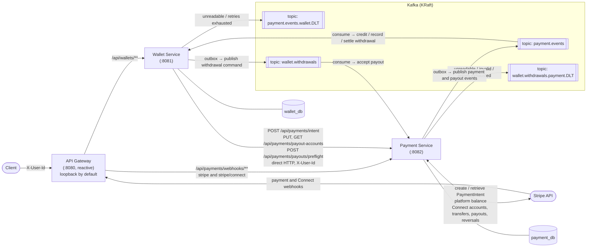

# FlowWallet


-231f20)


[](https://github.com/denys1204/FlowWallet/actions/workflows/ci.yml)

> **Event-driven microservices wallet system, built as an engineering showcase.**

FlowWallet is a backend platform that lets a user deposit into a digital wallet through an external payment provider
(Stripe), have the balance credited reliably and asynchronously through events, send money to another user's wallet in
the same currency, and withdraw to a bank account through Stripe Connect in test mode. It is built to demonstrate
production-grade patterns on a modern stack: a Transactional Outbox, so an event is written if and only if the change
behind it commits, and a failed send is retried rather than lost; an idempotent event consumer that credits a balance
once however often an event arrives; a pluggable payment-provider abstraction (Strategy + Factory); database-per-service
isolation; and clean module boundaries.

> **Project status:** release 1.0, the three services at 1.0.0. The deposit loop works end to end. A client asks its
> wallet to start a deposit, the wallet checks that the wallet exists and belongs to the caller, Payment Service creates
> a Stripe PaymentIntent, a signed webhook confirms the payment, the outbox publishes to Kafka, and the wallet credits
> the balance exactly once. A user can also send money to another user's wallet in the same currency, in one local
> transaction inside Wallet Service, and withdraw to a bank account through Stripe Connect: the wallet debits the
> balance, Payment Service pays out, and a payout that fails comes back as a credit. Integration tests run every one of
> these flows against real Postgres and Kafka in containers. See [Project status & roadmap](#project-status--roadmap).
>
> The project runs against Stripe test mode only and is not meant for production use: Stripe does not allow
> peer-to-peer money transmission on a live account.

---

## Table of contents

- [How it works](#how-it-works)
- [Documentation](#documentation)
- [Tech stack](#tech-stack)
- [Quickstart](#quickstart)
- [Project status & roadmap](#project-status--roadmap)

---

## How it works

FlowWallet runs as six Maven modules. A reactive API gateway sits in front of two servlet-based domain services, and
each service keeps its own Postgres database. Wallet Service calls Payment Service directly over HTTP to start a
deposit, to relay the caller's bank account and to check a withdrawal before it debits it, and sends the withdrawal to
Payment Service through Kafka. Payment Service reports the outcomes back through Kafka once Stripe confirms them.



See [ARCHITECTURE.md](ARCHITECTURE.md) for the module breakdown, the deposit, transfer and withdrawal flows, the outbox,
the wallet consumer and the identity model.

## Documentation

| Document | Answers |
|----------|---------|
| [ARCHITECTURE.md](ARCHITECTURE.md) | How the system works: the modules, the deposit flow, the outbox, the wallet consumer, transfers, withdrawals and the identity model |
| [docs/business-rules.md](docs/business-rules.md) | What the wallet allows and refuses, in business terms |
| [docs/adr/](docs/adr/README.md) | Why: one decision record per file, with the alternatives that were rejected |
| [docs/api.md](docs/api.md) | The API reference and error responses |
| [docs/data-model.md](docs/data-model.md) | The database schema for each service |
| [docs/events.md](docs/events.md) | The Kafka topics and event contracts |
| [docs/development.md](docs/development.md) | How to run, configure and test the project |
| [docs/operations.md](docs/operations.md) | The operator runbook: signals, checks and actions for withdrawals, payouts and deposits |
| [payment](flow-wallet-payment/CHANGELOG.md), [wallet](flow-wallet-service/CHANGELOG.md) and [gateway](flow-wallet-gateway/CHANGELOG.md) changelogs | Each service's release notes, written by release-please when the service is released |
| [CONTRIBUTING.md](CONTRIBUTING.md) | How to change the code: commands, conventions, what has to change together, and how a release is made |

## Tech stack

| Area | Technology |
|------|------------|
| Language | Java 25 |
| Framework | Spring Boot 4.1.0, Spring Cloud 2025.1.3 |
| Gateway | Spring Cloud Gateway (reactive / WebFlux) |
| Web / persistence | Spring MVC, Spring Data JPA, Hibernate |
| Service-to-service HTTP | Spring declarative HTTP interface (`@HttpExchange`) over `RestClient`, no Feign |
| Database | PostgreSQL 17, HikariCP, Liquibase migrations |
| Messaging | Apache Kafka 4.2.1 (KRaft mode, no ZooKeeper) |
| Payments | Stripe (`stripe-java` 33.1.0), test mode |
| JSON | Jackson 3 (`tools.jackson`) |
| Mapping | MapStruct 1.6.3 + Lombok |
| Resilience | Spring Retry (payment); Spring Kafka `DefaultErrorHandler` + a dead-letter topic per consumer (wallet and payment) |
| Testing | JUnit 6 and Mockito; integration tests on Testcontainers (PostgreSQL, Kafka) |
| Build & infra | Maven multi-module, Docker Compose |
| CI | GitHub Actions: every pull request to `main` is built and tested in full, integration tests included; Dependabot keeps the Maven dependencies and the actions current |
| Releases | release-please on GitHub Actions: one version, tag and changelog per service (`payment/v1.0.0`) |

## Quickstart

JDK 25, Docker and Docker Compose, and a Stripe test-mode account with the [Stripe CLI](https://docs.stripe.com/cli/install)
are the only prerequisites. Maven is optional: `./mvnw` downloads it on first run.

Configure the environment:

```bash
cp .env.example .env
```

Set `STRIPE_API_KEY` and `POSTGRES_PASSWORD` in `.env`. Leave `STRIPE_WEBHOOK_SECRET` and
`STRIPE_CONNECT_WEBHOOK_SECRET` empty for now; a later step gives you the real value. Until they are set, Payment
Service starts but refuses every webhook.

Start infrastructure:

```bash
docker compose up -d
```

Build:

```bash
./mvnw clean install
```

Run all three services, each in its own terminal:

```bash
./mvnw -pl flow-wallet-gateway spring-boot:run
./mvnw -pl flow-wallet-payment spring-boot:run
./mvnw -pl flow-wallet-service spring-boot:run
```

The gateway listens on `127.0.0.1` by default. It forwards `X-User-Id` as the client sent it, so it may listen wider
(`GATEWAY_ADDRESS`) only behind an authentication layer that sets the header
([ADR 0031](docs/adr/0031-callers-are-authenticated-in-front-of-the-gateway.md)).

Forward Stripe webhooks:

```bash
stripe listen --forward-to localhost:8080/api/payments/webhooks/stripe \
  --forward-connect-to localhost:8080/api/payments/webhooks/stripe/connect
```

`stripe listen` prints a webhook signing secret (`whsec_...`). It signs the events of both targets, so put it in both
`STRIPE_WEBHOOK_SECRET` and `STRIPE_CONNECT_WEBHOOK_SECRET` and restart Payment Service. Until you do, every webhook
comes back `400`, and a deposit you pay is credited only when the reconciler finds it, 15 minutes or more later.

See [docs/development.md](docs/development.md) for the full guide, configuration and testing.

## Project status & roadmap

This is a showcase that keeps changing. The deposit loop works end to end, transfers between wallets work against
real Postgres, and withdrawals to a bank account work through Stripe Connect in test mode, each with integration tests
on real Postgres and Kafka. Release 1.0 is the three services at `1.0.0`, released by release-please with a tag per
service ([ADR 0040](docs/adr/0040-services-are-released-on-their-own.md)).

1. ~~Wallet comes alive~~: done. Domain model and migrations, an idempotent Kafka consumer, and retries with
   backoff plus a dead-letter topic.
2. ~~The client drives the wallet~~: done. Wallet endpoints and deposits started through the wallet.
3. ~~Transfers between wallets~~: done, with their integration tests. Same currency only, the recipient named by user
   id, and one local transaction that locks both wallets in ascending user id.
4. ~~Withdrawals out to the payment provider~~: done, with integration tests on both the wallet's side and Payment
   Service's payout steps. Through Stripe Connect in test mode: the wallet debits under its lock
   and records a refusal under the key, Payment Service pays out, and a payout that fails comes back as a credit.
5. ~~Proof that it works~~: done. Integration tests against real Postgres and Kafka show that a redelivery doesn't
   credit twice, a duplicate reference is refused, a poison record lands in the dead-letter topic, and a deposit raises
   the balance end to end. For transfers they show that opposite transfers don't deadlock, that concurrent requests with
   one key move the money once, that a key raced from two senders goes to one of them whether or not the two transfers
   share a wallet, that concurrent transfers can't overdraw a wallet, and that a replay is byte for byte the first
   answer. For withdrawals they show that concurrent requests with one key debit once, that a key raced from two wallets
   goes to one of them, that concurrent withdrawals and transfers can't overdraw a wallet or deadlock, that the command
   commits with the debit, and that a returned payout credits once. Payment Service's tests drive the payout step
   machine through every state and show that a transfer or payout Stripe made before its answer was lost is adopted, not
   made twice.
6. ~~Continuous integration~~: done. GitHub Actions builds and tests every pull request and every push to `main`,
   integration tests included, and every change reaches `main` through a pull request
   ([ADR 0041](docs/adr/0041-changes-reach-main-through-pull-requests-built-by-ci.md)).

Stages, definitions of done and open decisions live in `implementation_plan.md`. It is a local working file
and deliberately isn't committed.
